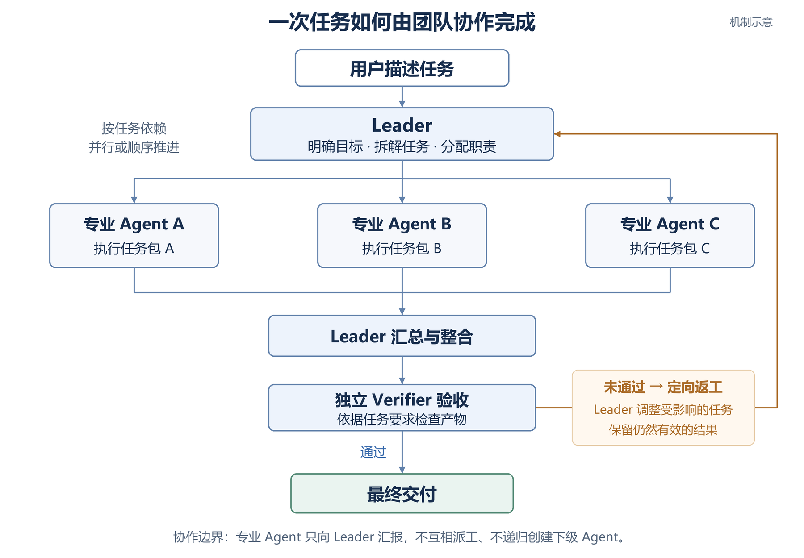
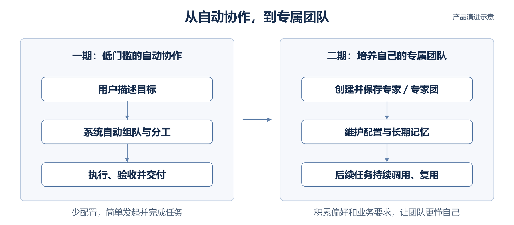

# SoWork Agent Team｜项目复盘PRD

在商汤 AI 产品经理实习期间，我参与了多智能体协作方案设计、原型迭代和模型测试。一期聚焦自动组队、分工与验收，二期完成面向长期使用的专属专家团需求设计。本文整理自项目结束后的个人复盘，保留原有六章和两张机制图。

## 一、项目背景与产品目标

### 1.1 原有产品形态与主要问题

SoWork 已有单 Agent、专家库、对话和工作空间等能力。用户可以交给 AI 一项工作，但当任务同时涉及调研、分析、制作和验证时，仍需要进一步解决如何组织多个专家、衔接工作和判断完成质量的问题。

- **复杂任务的组织成本高**　专家列表解决了“有哪些能力”，还需要有人负责拆任务、选成员、安排顺序并整合结果。
- **执行过程缺少清晰表达**　长任务需要让用户知道谁在处理、进行到哪一步、是否遇到阻塞，以及哪些产物已经可以查看。
- **交付需要明确完成标准**　生成一段回答或一个文件，不等于满足任务要求。需要把用户目标转成可检查的标准，并处理不合格结果。
- **团队经验需要持续复用**　同类工作反复发生时，用户希望保留稳定的团队配置、业务要求和偏好，减少每次重新组织和说明。

### 1.2 本次项目的产品目标

一期提供低门槛的自动协作模式。用户描述目标，系统负责组队和执行。二期方案支持用户培养自己的专家团队，通过保存配置和长期记忆，让团队逐步适应用户的业务、偏好和工作方式。

- **降低组织门槛**　用户无需先研究专家分工，系统围绕任务选择必要成员并统一调度。
- **提升交付可靠性**　规划、执行和独立验收各有职责，通过有限重试、局部返工和明确的结束状态保障交付。
- **让过程可以理解**　展示成员、任务进度、异常和产物，支持从整体进度进一步查看具体成员的工作。
- **形成长期使用能力**　逐步支持专家与团队的创建、管理、再次调用及记忆积累，使一次协作可以发展为持续合作。

## 二、整体协作机制与一期范围

### 2.1 团队角色与职责分工

团队采用“Leader 统一调度—专业 Agent 执行—Verifier 独立验收”的分工。用户面向一个整体提出任务，团队内部再完成规划、执行和检查。

| 角色 | 核心职责 |
| --- | --- |
| Leader | 理解目标、拆解任务、选择成员、分派工作、处理依赖、调整计划并整合交付。 |
| 专业 Agent | 执行具体工作，提交产物、证据及阻塞信息。 |
| Verifier | 按事先确定的标准独立验收，指出问题并提出返工要求。 |

Leader 负责“让工作有序推进”，专业 Agent 负责“把具体工作做出来”，Verifier 负责“判断结果是否满足要求”。将执行和验收分开，避免仅以执行者自述完成作为结束依据。

### 2.2 团队内部如何工作

- **统一调度**　任务拆解、成员分工和计划调整都由 Leader 负责。专业 Agent 不互相派活，也不递归创建下级 Agent，减少职责交叉和难以追踪的调用。
- **按依赖组织执行**　互不依赖的工作可以并行；需要前序结果的工作等待对应输入，再继续推进。
- **先明确任务要求**　子任务需要说明负责人、输入、预期产物和验收要求，让成员知道做什么、交什么，以及什么情况下算完成。
- **对受影响的工作返工**　Verifier 检查不通过后，将问题交回 Leader 重新安排；保留仍然有效的结果，避免整项任务无差别重做。

### 2.3 一期为什么先聚焦自动组队

完整构想同时包含自动组队、主动选择专家团、自定义团队和长期记忆。若在首版同时展开，用户需要理解的入口和产品需要处理的分支都会增加。因此，一期先围绕“描述任务后直接开始协作”建立完整流程。

一期需求聚焦自动组队、成员展示、执行进程、澄清、异常处理、验收和交付。多 Agent 模式下先隐藏手动“召唤专家”入口，由系统选择必要成员；专家与团队的创建、管理和长期复用在后续版本继续展开。

这一取舍使一期首先回答：用户不需要学习如何搭团队，能否简单发起任务，并理解、获取最终结果。

## 三、一期核心流程与交互设计

### 3.1 任务入口与自动组队

输入框提供普通模式与多 Agent 模式切换，切换时保留已输入的目标和附件，避免用户重复准备材料。选择多 Agent 模式并提交任务后，由系统根据任务需要选择专家，或按需创建专业 Agent。

团队成员随规划逐个展示。界面仅在成员确定后显示其身份，避免先呈现一套固定阵容，再在执行中大幅变化。用户看到的是本次任务实际参与的成员。

### 3.2 成员展示与任务进程

界面以成员胶囊、主运行面板和子 Agent 面板承接不同层次的信息。

- **成员胶囊**　按 Leader、专业 Agent、Verifier 的顺序排列；专业 Agent 按调用先后展示。胶囊包含头像、名称和状态，区分运行中、已完成及最终失败，临时失败后的自动尝试仍保持运行状态。
- **主运行面板**　展示整体执行节点和全局任务列表，任务项区分等待、运行中和已完成，帮助用户判断整体进展。
- **子 Agent 面板**　点击成员胶囊，可查看该成员接收的任务、执行情况和文件产物；不重复展示全局任务列表。

主界面回答“整体进行到哪里”，成员详情回答“具体是谁在做、做出了什么”。这样既保留简洁的使用入口，也提供进一步查看的路径。

### 3.3 澄清、重试与异常处理

澄清用于处理影响目标、范围或关键约束的歧义。需要用户决定时，在执行节点中展示澄清弹窗，支持单选、多选和自定义补充；系统暂停后续运行，收到确认后继续规划或执行。

执行失败与验收不通过采用不同处理方式：

- **执行失败后的自动重试**　遇到暂时性故障时自动尝试恢复。如果工作的安排本身有问题，则由 Leader 调整受影响的子任务。
- **验收不通过后的局部返工**　Verifier 指出未满足的要求，Leader 只重新安排受影响的任务。达到返工上限后，给出明确结论。
- **达到限制后的结果判断**　不继续无限尝试，由 Verifier 根据整体产物判断任务是否合格，并呈现最终结果和失败说明。

网络断开、积分不足、上游模型出错等外部异常，由对话反馈具体情况。成员的中途异常与任务最终失败分开表达，避免用户把一次重试误认为整个任务已经结束。

### 3.4 结果交付与任务连续性

结果界面需要同时呈现任务结论和可取用的产物。成功时，整体执行状态结束为“已完成”，成员状态同步收口，并按现有展示方式呈现图片、文档、压缩包、音频或视频等产物；失败时呈现“已失败”及具体说明，帮助用户理解任务在哪里停止。

同一次提交对应一项任务。重复点击或重新进入页面时，用户仍能看到这项任务的阶段、成员、产物和待办。用户离开页面后任务可以继续，主动取消则结束本次执行。

原型通过三条路径展示这套交互：

- **成功路径**　提交任务后，成员依次出现；任务列表随执行更新，最终呈现完成状态和交付产物。
- **失败路径**　执行中出现异常并尝试恢复；无法继续时结束任务，区分运行中的异常与最终失败。
- **澄清路径**　遇到关键歧义时暂停，收集用户选择或补充后继续推进。

[下载 Agent Team 试跑 Demo（自测版）](Agent%20Team试跑Demo（自测版）.html)。这是我在项目期间试跑的 V3 交互原型。用桌面浏览器打开，在多 Agent 模式下输入任务，确认组队方案后展开任务列表，逐步查看执行与交付。

## 四、方案评审、原型迭代与多模型验证

### 4.1 关键评审意见如何转化为产品调整

全量方案评审同时覆盖自动协作，以及主动召唤、长期团队和记忆等后续能力。评审将部分理想交互调整为当时可支持、用户更容易理解的形式；一期则按自动组队主线进一步收敛。

| 评审中的问题 | 方案调整 | 原因与价值 |
| --- | --- | --- |
| 借调专家原计划通过按钮确认 | 在全量方案中改为对话告知需借调的专家，用户在输入框回复。 | 当时模型无法在对话中返回可点击按钮，采用能够支持的文字交互。 |
| 召唤对象与当前模式不匹配 | 在全量方案中改为随所选对象自动匹配普通或多 Agent 模式。 | 减少报错和额外切换；一期隐藏多 Agent 模式的手动召唤入口，后续再展开这一路径。 |
| 长期记忆包含多个状态入口 | 简化为可查看、编辑的记忆文档入口。 | 减少管理负担，让用户直接维护需要保留的信息；在二期继续具体化。 |
| 运行时只能查看 Leader 面板 | 增加子 Agent 运行情况的查看入口。 | 帮助用户理解分工、定位问题，并查看对应成员的产物。 |

这些调整分别解决了能力约束、操作负担和过程可见性问题。

### 4.2 多模型测试如何开展

测试围绕真实工作任务展开：用户提出调研与制作要求，模型需要组织执行，并交付本地 HTML 工具或其他指定成果。任务涵盖项目管理工具选型、员工福利预算、供应商比较、市场分析、会议策划等场景。

| 测试轮次 | 覆盖范围 | 主要观察内容 |
| --- | --- | --- |
| 首轮测试 | 14款模型 | 是否调用多 Agent、是否出现执行异常、任务完成情况、耗时和交付形式。 |
| 第二轮复测 | 其中10款模型 | 继续观察自动调度、任务完成表现、服务稳定性及并发执行。 |

两轮任务的复杂度不同。测试将每次运行的任务要求、执行过程和交付结果一起分析，以定位调度、稳定性和交付问题。

### 4.3 测试发现了哪些关键问题

- **团队触发不足**　部分模型面对复杂任务时仍以单 Agent 执行，用户需要再次明确提出分工要求。由此把“能否按任务主动组队”列为复测重点。
- **失败原因需要可区分**　未发生调度、任务执行中断和服务暂时不可用，在界面上都可能表现为等待。运行状态需要标明停在哪一步，便于决定等待、重试或调整计划。
- **生成了文件，用户仍可能打不开**　测试中出现过结果说明直接显示链接语法的情况。因此验收还要从用户侧实际打开文件，并核对它是否满足任务要求。
- **调用方式需要匹配任务**　多 Agent 的数量并非越多越好。简单任务应能够直接完成，复杂任务需要模型主动判断是否拆解、并行及引入不同专业能力，减少用户补充指挥。

### 4.4 代表性复测结果与产品判断

**观察模型能否按任务选择执行方式**

同轮测试中，销售线索评分工具由单 Agent 完成，涉及多个市场因素的调研任务则主动调用了多个 Agent。两项任务都交付了结果。

这组案例体现了该次测试中的任务判断：简单工作流直接完成，需要跨市场、多因素研究的任务再展开团队协作。产品评价应关注能否减少用户组织工作，而不是单独追求更多 Agent 参与。

**观察并发任务能否分别交付**

复测同时提交了制度生成器、选址比较工具和培训网站三项任务，分别核对每个任务的结束状态及对应文件。

三项任务均记录完成，并分别生成对应的本地 HTML 产物，为并发执行场景提供了具体测试案例。

**交付展示：把“用户能否使用”纳入完成判断**

结合文件、链接与结果说明检查交付：不仅查看是否生成 HTML 或其他文件，还要关注用户是否清楚成果位置、是否能打开，以及最终说明是否对应实际产物。原样输出链接语法等现象说明，交付展示本身也是产品需要验证的一环。

综合这些测试，一期验证需要同时关注合理组队、持续执行、异常表达和可用交付。测试记录为后续定位问题和选择复测场景提供依据。

## 五、二期产品演进

### 5.1 相比一期，二期新增和扩展了哪些产品板块

一期以低门槛的自动协作为核心：用户描述目标，系统自动组建团队、安排分工并推进交付，让用户无需掌握团队设计和调度方法，也能借助多个 Agent 解决任务。

二期方案进一步面向长期使用，支持用户培养一支越来越懂自己的专属团队。通过创建和维护专家、保存团队配置，并结合长期记忆保留稳定偏好、业务要求和工作方式，后续任务可以复用已有积累，减少重复说明。

这些能力具体落在四个产品板块。

| 产品板块 | 二期新增或完善的功能 | 用户价值 |
| --- | --- | --- |
| 专家广场：扩展官方专家团 | 在已有专家库基础上补充官方专家团，提供展示、查找和一键召唤入口。 | 直接选择适合当前任务的官方团队。 |
| 我的专家／专家团：新增自定义与管理 | 支持 AI 创建专家或专家团、从已有专家中自由组队；保存后可编辑成员和配置、再次调用，并进入专属对话空间。 | 建立可反复使用的专属团队，持续维护团队的分工和工作方式。 |
| 项目与会话：扩展项目级多会话 | 同一项目下组织多个会话，管理项目源文件，在适用范围内复用项目材料和上下文。 | 围绕同一项目分多轮工作，减少反复上传材料和交代背景。 |
| 模型选择区：完善选择信息与控制项 | 展示模型简介、擅长方向和积分消耗倍数，提供思考强度选择。 | 结合任务需要和消耗，选择合适的模型及思考强度。 |

### 5.2 临时使用与长期使用的逻辑

临时协作服务于当前任务；长期专家与团队则作为持续使用的对象被保存下来。两者在入口、任务结束后的保留方式，以及记忆归属上分别设计。

- **临时使用**　完成当前任务：用户从专家广场召唤专家或专家团，完成任务后结束本次临时协作。会话及相关的会话记忆、项目记忆由 SoWork 承接；临时调用不为专家或团队积累长期记忆。
- **长期使用**　持续调用同一专家或团队：用户从侧边栏或“我的专家／专家团”进入专属对话空间。专家和团队保存在工作区中，后续可再次调用、调整成员与配置；对应空间的会话和项目记忆由该专家或团队承接。
- **分层记忆**　按适用范围复用信息：会话记忆承接当前交流，项目记忆支持同一项目下的多会话；长期团队和专家分别积累适用的团队级、专家级记忆。团队记忆以可查看、编辑和保存的文档形式管理，让用户能够修正需要长期保留的信息。
- **团队配置与本次分工分开管理**　保存的团队配置用于长期复用，每次任务再依据当前需求安排实际参与成员与分工，让稳定的团队能够承接不同任务。

## 六、项目阶段成果

### 6.1 已形成的产品与验证成果

项目已形成从协作机制、一期交互到二期需求的产品方案，并通过原型和多模型测试检验关键环节。当前成果主要体现在设计与验证阶段。

- **形成完整的协作机制**　明确 Leader、专业 Agent 与 Verifier 的职责，以及任务拆解、分派、执行、验收、返工和交付规则。
- **完成一期范围与交互表达**　将全量构想收敛为自动组队流程，通过交互原型展示成员状态、任务进程、澄清、异常和结果交付，并结合评审调整具体路径。
- 完成首轮 14 款模型测试，并复测其中 10 款。测试明确了后续需要追踪的现象，包括复杂任务能否主动组队、执行中断能否定位、产物能否打开，也记录了复杂任务与并发任务的交付案例。
- **形成二期产品需求**　进一步明确专家广场、我的专家／专家团、项目多会话和模型选择的功能，并细化创建、保存、管理、召回及记忆归属。

### 6.2 阶段成果体现的产品价值

- **一期**　让用户简单发起，系统组织协作：把多 Agent 的调度能力转化为用户能够使用的流程：描述目标后，由系统组队和执行，用户可以理解进度、查看问题并获取产物。
- **二期**　让团队能够长期积累，逐步适应用户：通过可管理的专家与团队、项目空间和长期记忆，承接重复发生的工作，让稳定偏好和工作要求在后续任务中继续发挥作用，逐步形成专属团队。
